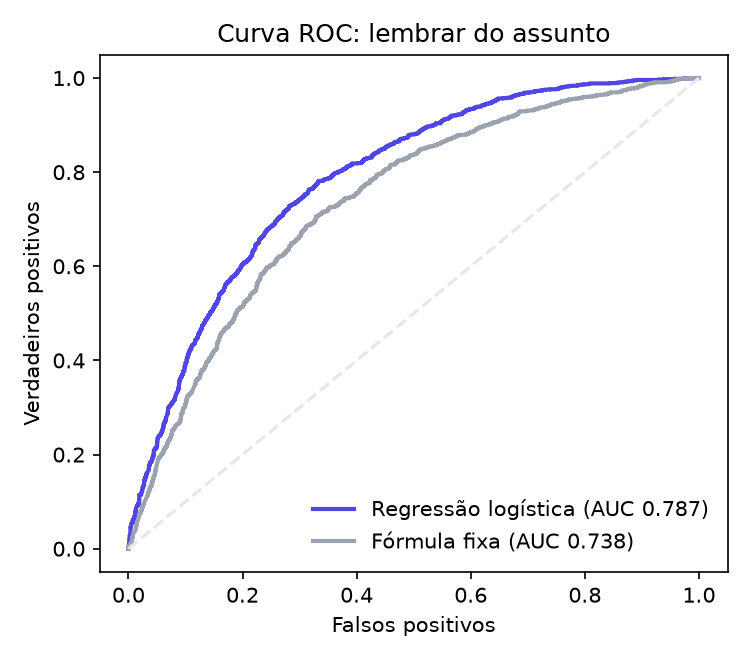
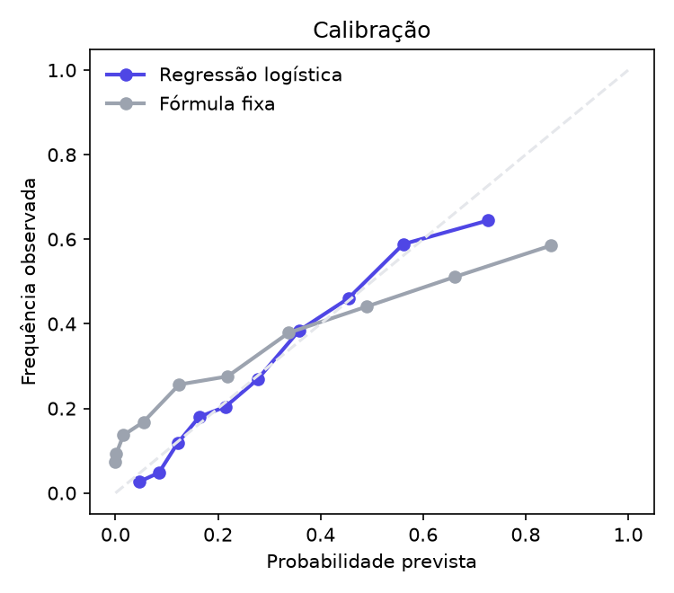

# Relatório dos modelos

Dados **simulados** por `gerar_dataset.py`: 500 alunos fictícios. As métricas
medem o quanto o modelo recupera a simulação, não o desempenho com alunos reais.

## Esquecimento

Regressão logística com `log1p(dias)`, `qtd_revisoes`, `dificuldade` e
`taxa_acerto_aluno`. 21238 eventos, 4171 no teste, separados por aluno.

| Modelo | AUC | Acurácia | Brier |
|---|---|---:|---:|
| Regressão logística | 0.787 | 0.754 | 0.164 |
| Fórmula fixa `exp(-dias / (1 + qtd_revisoes))` | 0.738 | 0.726 | 0.193 |

## Proficiência

Dificuldade `b` de 44 questões, por regressão logística com one-hot de
aluno e de questão, sobre 15000 respostas. Correlação entre o `b` estimado
e o `b` usado na simulação: **0.985**.
